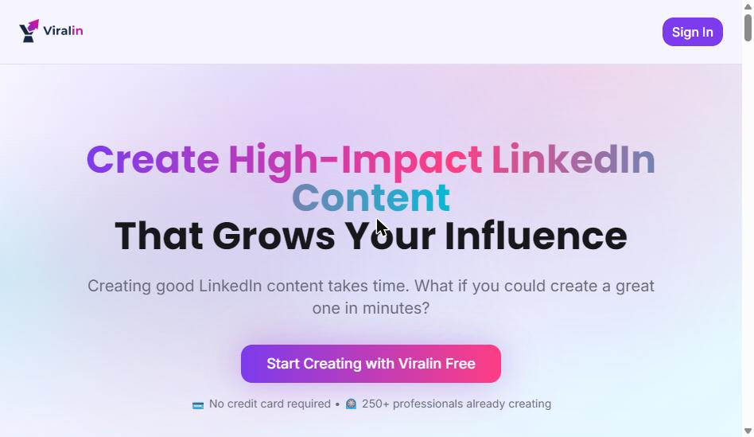
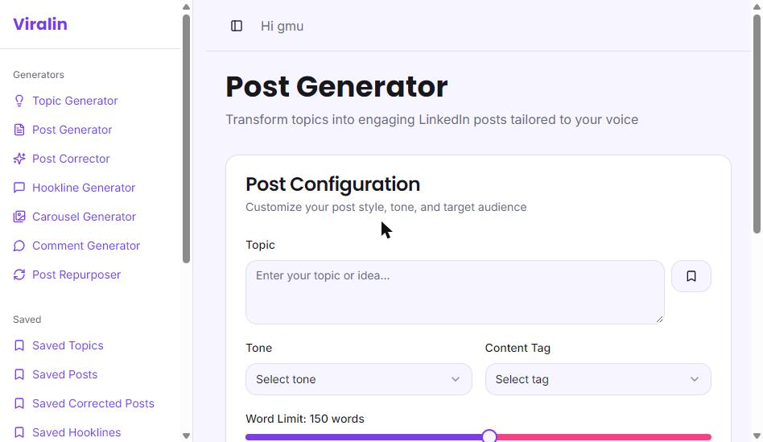
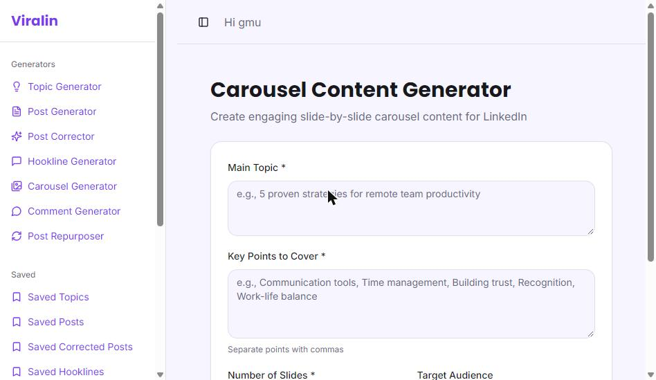
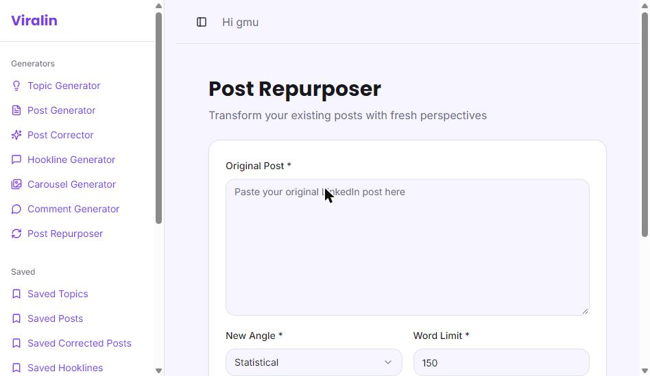

# Viralin

AI-powered LinkedIn content generator. Viralin helps you go from a blank page to a ready-to-post LinkedIn post, with seven tools in one dashboard. It is my first AI project.

**Live site:** [viralin.lovable.app](https://viralin.lovable.app)

## Tools
- **Topic Generator:** topic ideas for your niche and audience, with a viral potential score, best posting time and hashtags.
- **Post Generator:** turns a topic into a post with your chosen tone, tag, word limit (40 to 250), audience and goal.
- **Post Corrector:** polishes a rough draft while keeping your voice.
- **Hookline Generator:** opening lines that make people keep reading.
- **Carousel Generator:** slide-by-slide carousel content from a topic and key points.
- **Comment Generator:** thoughtful comments for other people's posts, in different styles.
- **Post Repurposer:** rewrites an existing post with a new angle, such as statistical.

Also included: saved libraries for topics, posts, corrected posts, hooklines, carousels, comments and repurposed posts, plus a history page, profile and settings.

## Screenshots

## Built with
Built in Lovable, powered by a Gemini Flash model.

## Note
This repo is a showcase of the live product. The source code is private.

## Contact
[agniva.work26@gmail.com](mailto:agniva.work26@gmail.com)
